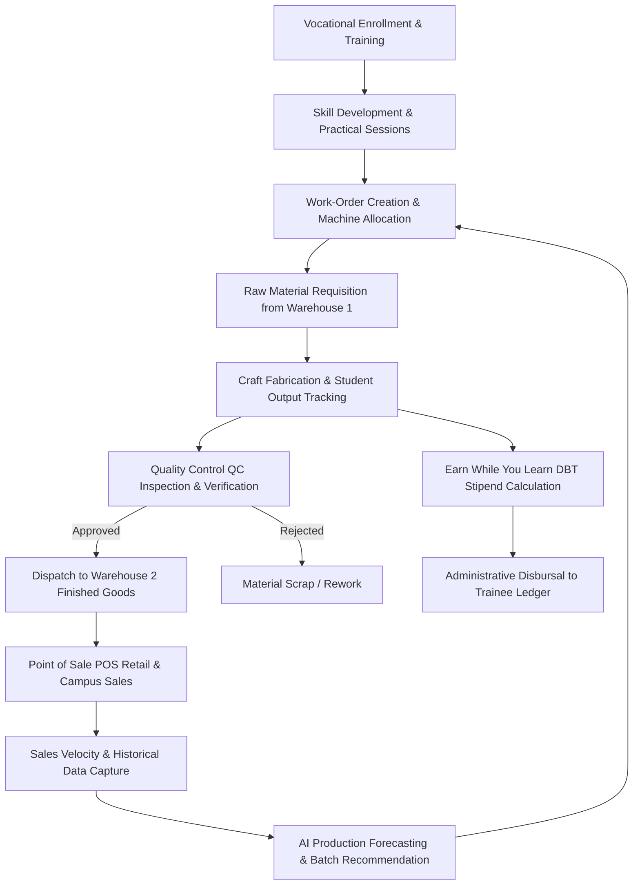

# SOFTWARE REQUIREMENTS SPECIFICATION (SRS)
## KISS Vocational Training Management System (KV-TMS)

**Project Type:** Web-Based Enterprise Software System  
**Development Model:** Hybrid Waterfall–Incremental Model  
**Document Version:** 1.0 (Initial System Specification)  
**Date:** October 2026  
**Prepared By:** Mansi Sinha  
**Course:** B.Tech. Computer Science & Engineering  
**Institution:** KIIT School of Computer Science and Engineering  
**Client Institution:** Kalinga Institute of Social Sciences (KISS), Bhubaneswar, Odisha  

---

## 1. INTRODUCTION

### 1.1 Purpose
The purpose of the **KISS Vocational Training Management System (KV-TMS)** is to provide an end-to-end, integrated enterprise platform that manages all aspects of vocational education, hands-on production, supply chain logistics, commercialization, and trainee welfare.

KV-TMS links practical skills training directly with real-world production and revenue generation. The platform enables:
1. **Trainees** to participate in vocational trades, track training syllabi, monitor attendance, apply for leaves, view assessment scores, and track **Direct Benefit Transfer (DBT)** incentive stipends earned through production.
2. **Trainers / Faculty** to conduct vocational courses, maintain syllabi, record daily attendance, evaluate performance milestones, and approve trainee leave requests.
3. **Production Managers / Workshop Staff** to oversee shop-floor operations, allocate machines and batches, log raw material consumption, perform Quality Control (QC) inspections, and transition approved crafts to finished goods inventory.
4. **Administrators** to manage role-based user accounts, oversee academic curricula, coordinate warehouse logistics, operate Point of Sale (POS) retail billing, broadcast institutional notices, and monitor system analytics.
5. **Community Visitors & Applicants** to explore the public showcase portal, review trade offerings, inspect live training metrics, and submit admission inquiries.
6. An **AI-Powered Production Forecasting Engine** that analyzes sales history, production velocity, and current stock levels to predict demand and recommend optimal production batch volumes.

### 1.2 Background
Vocational education empowers marginalized students by imparting market-relevant, sustainable skills that foster financial self-reliance and entrepreneurship. At Kalinga Institute of Social Sciences (KISS), vocational training is tightly coupled with production workshops—such as Apparels & Tailoring, Terracotta & Pottery, Bamboo & Handicrafts, Food Processing, and Allied Trades. 

In this model, training is not merely academic; trainees learn foundational skills under expert faculty, participate in manufacturing tangible commercial-grade products, and receive monetary stipends through the **"Earn While You Learn" (EWYL)** initiative. KV-TMS digitizes this entire cycle into a unified digital pipeline:
$$\text{Vocational Training} \longrightarrow \text{Skill Acquisition} \longrightarrow \text{Product Fabrication} \longrightarrow \text{Quality Inspection} \longrightarrow \text{Dual-Warehouse Storage} \longrightarrow \text{POS Retail Sales} \longrightarrow \text{DBT Trainee Stipends} \longrightarrow \text{AI Demand Planning}$$

### 1.3 Problem Statement
Prior to KV-TMS, vocational training, workshop fabrication, raw material stocking, and campus sales were administered through disparate manual registers and spreadsheets. This led to:
- Disconnected records between student attendance and actual workshop output.
- Lack of traceability regarding which trainee crafted which inventory item.
- Manual errors and delays in calculating student stipends under the Earn-While-You-Learn program.
- Inaccurate stock levels across raw materials and finished goods, causing production bottlenecks or overstocking.
- Absence of data-driven demand forecasting, resulting in reactive rather than proactive production planning.

KV-TMS solves these challenges through a centralized, role-based architecture with four distinct user classes:
1. **Trainees / Students (`ROLE_TRAINEE`)**
2. **Trainers / Faculty (`ROLE_TRAINER`)**
3. **Production Managers / Workshop Staff (`ROLE_PRODUCTION_MANAGER`)**
4. **System Administrators (`ROLE_ADMIN`)**

### 1.4 Objectives
The primary objectives of KV-TMS are:
- Provide a centralized digital platform for managing vocational courses, curricula, and student allocations.
- Implement secure, stateless role-based authentication and authorization using JSON Web Tokens (JWT) and BCrypt encryption.
- Maintain accurate attendance records and provide a structured leave application and approval workflow.
- Maintain comprehensive trainee performance and competency assessment records.
- Track production runs from raw material requisition and bill of materials (BOM) consumption to shop-floor quality inspection.
- Operate a **Two-Tier Dual-Warehouse Architecture** segregating Raw Materials (Warehouse 1) from Finished Goods (Warehouse 2).
- Provide a full-featured **Sales Point of Sale (POS) Terminal** with dynamic cart calculation, tax computation, multi-tender payment support, printable digital receipts, and automated warehouse deduction.
- Automate trainee stipend calculations and Direct Benefit Transfer (DBT) disbarment ledgers under the Earn-While-You-Learn program.
- Deploy an institutional **Notice Board** engine for targeted, multi-role announcement broadcasting.
- Utilize an embedded **AI Demand Forecasting Engine** using time-series statistical modeling to assist administrators in production batch planning.
- Feature a public-facing **Institutional Showcase Web Portal** with live impact counters, trade catalogs, artisan stories, and session-preserving navigation bridges.

---

## 2. SCOPE OF THE SYSTEM

### 2.1 Overview
KV-TMS is a responsive, web-based enterprise application built with a decoupled client-server architecture:
- **Client Tier:** React 19 Single Page Application (SPA) powered by Vite, styled using Tailwind CSS, Lucide React icons, and Recharts visualization.
- **Server Tier:** Java 17+ Enterprise REST API powered by Spring Boot 3.x, Spring Security (JWT), and Spring Data JPA / Hibernate ORM.
- **Database Tier:** Relational database management system (H2 In-Memory for evaluation/development; PostgreSQL/MySQL compatible for production deployment).

### 2.2 Functional Scope
KV-TMS delivers 15 major functional modules:

```
+---------------------------------------------------------------------------------------------------+
|                                  KV-TMS FUNCTIONAL ARCHITECTURE                                   |
+---------------------------------------------------------------------------------------------------+
|  [01] Public Showcase Portal (Impact Counters, Trade Directory, Artisan Stories, Session Bridge)  |
|  [02] User Authentication & RBAC (JWT, BCrypt, 4 Roles, Production Staff Self-Registration)      |
|  [03] Trainee Management & Profiling (Batch Enrollment, Demographics, Progress Tracking)         |
|  [04] Trainer & Faculty Management (Specialization, Trade Assignments, Class Scheduling)          |
|  [05] Course & Curriculum Management (Trade Tracks, Modules, Competency Syllabi)                 |
|  [06] Attendance & Leave Workflow (Daily Marking, Leave Requests, Trainer Approval Engine)        |
|  [07] Competency Assessment & Grading (Practical Scores, Remarks, Progress Analytics)             |
|  [08] Product Catalog Management (SKUs, Trade Categories, Specifications, Unit Pricing)           |
|  [09] Shop-Floor Production Unit (Work Orders, Raw Material BOM, Machine Run, QC Inspection)      |
|  [10] Dual-Warehouse Logistics (Warehouse 1: Raw Materials | Warehouse 2: Finished Goods)        |
|  [11] Point of Sale (POS) Billing Terminal (Live Cart, GST/Tax, Multi-Tender, Printable Receipt)  |
|  [12] Earn While Learn & DBT Disbursal (Output-Linked Stipends, Bank Ledgers, Disbursal Approval) |
|  [13] Notice Board & Institutional Broadcast (Role-Targeted Bulletins, Priority Flags)            |
|  [14] AI-Driven Production Forecasting (Time-Series Smoothing, Trend Analysis, Safety Stock)     |
|  [15] System Administration & Audit Reporting (User Governance, Metric Dashboards, Export Logs)  |
+---------------------------------------------------------------------------------------------------+
```

### 2.3 User Classes Covered by the System
KV-TMS provides dedicated interfaces and capabilities for four user classes:

| User Class | System Role Identifier | Primary Responsibilities |
|---|---|---|
| **Trainee / Student** | `ROLE_TRAINEE` | View enrolled trade and syllabus; track daily attendance; apply for leaves with categorical reasons; review competency scores; track Earn-While-You-Learn production contributions and DBT stipend disbursement status; view institutional notices. |
| **Trainer / Faculty** | `ROLE_TRAINER` | Manage trade curricula and syllabus modules; record daily batch attendance; review and approve/reject trainee leave applications; evaluate practical performance and assign grades; view batch reports and institutional bulletins. |
| **Production Manager / Workshop Staff** | `ROLE_PRODUCTION_MANAGER` | Initiate and monitor manufacturing work-orders; track raw material consumption against Bills of Materials (BOM); perform Quality Control (QC) inspection; verify trainee production units; hand over approved finished crafts to Warehouse 2. |
| **Administrator** | `ROLE_ADMIN` | Full system governance; register and manage user accounts (Trainees, Trainers, Production Managers); oversee trade configurations; manage Dual-Warehouse stock and low-inventory alerts; process Point-of-Sale (POS) retail billing; approve DBT stipend payouts; broadcast institutional notices; inspect AI forecasting recommendations. |

### 2.4 System Workflow
The core operational pipeline connects academic learning to production, commercialization, and welfare:



### 2.5 Scope Boundaries
- **In Scope:** Digital management of all academic training, attendance, leave approvals, production batching, dual-warehouse inventory, retail POS billing, DBT incentive ledgers, notice broadcasting, AI decision-support forecasting, and public website showcase.
- **Out of Scope (By Design):** Physical workshop machinery operation; physical material transport and logistics; external automated banking gateways (payments handled via verified cash/UPI/card tender records with internal DBT ledger approvals); automated physical warehouse robotics.

---

## 3. OVERALL DESCRIPTION

### 3.1 Product Perspective
KV-TMS is an autonomous, full-stack enterprise web application designed to replace fragmented legacy workflows at KISS. It is deployed as a decoupled architecture where the front-end SPA communicates with the backend REST API over HTTP/JSON using stateless JWT authorization headers.

### 3.2 Major Product Functions

#### 3.2.1 Authentication and Access Control
- Secure login endpoint (`POST /api/v1/auth/login`) generating cryptographic JWT tokens containing subject, roles, and expiration claims.
- Public Production Staff self-registration endpoint (`POST /api/v1/auth/register-production-staff`) with automatic `ROLE_PRODUCTION_MANAGER` assignment.
- Role-based route guards in the React client dynamically redirecting users to their dedicated dashboard:
  - Trainee $\rightarrow$ Trainee Portal (`/portal`)
  - Trainer $\rightarrow$ Trainer Console (`/trainer`)
  - Production Staff $\rightarrow$ Production Unit (`/production`)
  - Administrator $\rightarrow$ Admin Console (`/admin`)

#### 3.2.2 Public Institutional Showcase Portal
- A modern landing page styled in KISS brand colors (Leaf Green `#48B859`, Royal Indigo `#2D3591`, Warm Gold `#fcb900`).
- Interactive counters displaying total trainees empowered, trades offered, and products crafted.
- Trade track directory highlighting Tailoring, Terracotta, Bamboo Crafts, and Food Processing.
- Trainee artisan spotlights and testimonial carousels.
- Contextual navigation bridge: Visitors with an active JWT token see a prominent "Back to Console" CTA button that preserves their session.

#### 3.2.3 Two-Tier Dual-Warehouse Architecture
- **Warehouse 1 (Raw Materials Depot):**
  - Manages bulk raw inputs (fabrics, clay, bamboo, threads, dyes).
  - Configurable minimum reorder thresholds with visual alert indicators.
  - Purchase order (PO) generation and supplier intake logging.
- **Warehouse 2 (Finished Goods Distribution Hub):**
  - Manages market-ready products received after Quality Control inspection.
  - SKU barcoding, category tagging, unit pricing, and packaging details.
  - Direct integration with the Point-of-Sale terminal for automatic stock decrement upon sale.

#### 3.2.4 Point of Sale (POS) Billing Terminal
- Real-time product search by SKU, name, or trade category.
- Interactive cart management with dynamic line-item quantity controls.
- Automatic tax computation (configurable GST rates) and subtotal calculations.
- Multi-tender payment acceptance (Cash, UPI, Credit/Debit Card).
- Instant digital receipt and invoice generation suitable for printing or customer review.
- Atomic database transactions deducting sold quantities from Warehouse 2.

#### 3.2.5 Earn While You Learn (EWYL) & DBT Stipend Engine
- Automatic calculation of trainee earnings based on approved production output units multiplied by trade piece rates.
- Verification workflow requiring Production Manager QC confirmation before incentive accreditation.
- Direct Benefit Transfer (DBT) disbursement ledger tracking bank account numbers, Aadhaar linkage status, payment references, and disbursement dates.
- Real-time trainee earning dashboards showing cumulative earnings, pending disbursements, and transaction history.

#### 3.2.6 Attendance and Leave Management Workflow
- Daily attendance logging by trainers (Present, Absent, Late, Excused).
- Trainee leave application module allowing students to submit leave requests with date ranges and categorical justifications (Medical, Personal, Academic).
- Trainer/Admin leave review console supporting one-click approval or rejection with audit feedback.

#### 3.2.7 Institutional Notice Board
- Priority-ranked announcements (Urgent, General, Academic, Event).
- Role-targeted distribution (All, Trainees Only, Trainers Only, Workshop Staff Only).
- Real-time announcement cards integrated into user dashboards.

#### 3.2.8 AI-Powered Production Forecasting
- Statistical forecasting algorithms (Holt-Winters Exponential Smoothing, Moving Average Trends, Linear Regression).
- Ingestion of historical sales velocity, production lead times, and current dual-warehouse stock levels.
- Automated output of predicted 30-day demand curves and recommended production batch quantities.
- Decision-support presentation preserving administrative human-in-the-loop governance.

### 3.3 User Classes and Characteristics

```
+----------------------------------------------------------------------------------------------------+
|                                    USER CLASS ACCESS MATRIX                                        |
+--------------------------+---------------+---------------+-----------------------+-----------------+
| Functional Capability    | Trainee       | Trainer       | Production Manager    | Administrator   |
+--------------------------+---------------+---------------+-----------------------+-----------------+
| Public Showcase Access   | Read          | Read          | Read                  | Read            |
| View Enrolled Syllabi    | Read          | Full Control  | Read                  | Full Control    |
| Mark Daily Attendance    | View Own      | Full Control  | View Workshop         | Full Control    |
| Apply for Leaves         | Create/View   | Review/Approve| View                  | Full Control    |
| Record Trainee Scores    | View Own      | Full Control  | N/A                   | Full Control    |
| Production Work Orders   | View Assigned | View          | Full Control          | Full Control    |
| QC Verification          | N/A           | N/A           | Full Control          | Full Control    |
| Warehouse 1 (Raw Mats)   | N/A           | View          | Requisition/Update    | Full Control    |
| Warehouse 2 (Finished)   | N/A           | View          | Stock Intake/View     | Full Control    |
| POS Retail Billing       | N/A           | N/A           | N/A                   | Full Control    |
| EWYL / DBT Stipends      | View Own      | View Batch    | Verify Units          | Disburse/Manage |
| Broadcast Notices        | View Allowed  | Create Trade  | Create Workshop       | Full Control    |
| AI Demand Forecasting    | N/A           | N/A           | View Projections      | Full Control    |
| User Account Management  | N/A           | N/A           | Self-Register Staff   | Full Control    |
+--------------------------+---------------+---------------+-----------------------+-----------------+
```

### 3.4 Operating Environment
- **Client Platforms:** Modern evergreen web browsers (Google Chrome 110+, Mozilla Firefox 115+, Microsoft Edge 110+, Safari 16+) across desktop computers, workstations, laptops, and tablets.
- **Frontend Stack:** React 19.x SPA, Vite 8.x build bundler, Tailwind CSS 4.x utility framework, Lucide React icons, Recharts SVG charting.
- **Application Server:** Java Virtual Machine (JVM 17+ LTS), Spring Boot 3.x, Embedded Tomcat 10.x.
- **Security & Cryptography:** Spring Security 6.x, `jjwt` (Java JWT 0.11.x), BCrypt password hashing (10 salt rounds).
- **Persistence & ORM:** Spring Data JPA, Hibernate 6.x, Jakarta Persistence API.
- **Database Engine:** H2 Database Engine 2.x (In-Memory embedded mode for demonstration/evaluation); schema engineered for PostgreSQL 15+ / MySQL 8.x production environments.
- **Network Protocol:** HTTP/1.1 and HTTP/2 over TLS 1.3 (HTTPS).

### 3.5 Design and Implementation Constraints
- **Stateless Architecture:** The backend maintains no HTTP session state; all authentication state resides in signed JSON Web Tokens exchanged in the `Authorization: Bearer <token>` header.
- **Deterministic Transactional Boundaries:** All multi-step inventory transitions (raw material deduction during production, finished goods addition upon QC pass, and finished goods deduction during POS checkout) are wrapped in `@Transactional` database boundaries to prevent phantom stock or race conditions.
- **Responsive Layout:** All user consoles and the public showcase portal are responsive across standard display breakpoints (`sm: 640px`, `md: 768px`, `lg: 1024px`, `xl: 1280px`).
- **Brand Consistency:** Strict visual fidelity adhering to the institutional brand scheme:
  - Primary Brand Green: Leaf Green `#48B859`
  - Secondary Accent Indigo: Royal Indigo `#2D3591`
  - Accent Gold: Warm Gold `#fcb900`

---

## 4. FUNCTIONAL REQUIREMENTS

### 4.1 Authentication and Access Control
- **FR-AUTH-01:** The system shall provide a secure login endpoint (`POST /api/v1/auth/login`) accepting username and password credentials.
- **FR-AUTH-02:** Upon successful credential validation, the system shall return an HTTP 200 response containing a cryptographic JWT access token, user identifier, full name, and granted authority (`ROLE_TRAINEE`, `ROLE_TRAINER`, `ROLE_PRODUCTION_MANAGER`, `ROLE_ADMIN`).
- **FR-AUTH-03:** The system shall provide a dedicated self-registration endpoint for Production Staff (`POST /api/v1/auth/register-production-staff`) requiring username, password, full name, email, and workshop specialization.
- **FR-AUTH-04:** The system shall reject expired or tampered JWT tokens with HTTP 401 Unauthorized status.
- **FR-AUTH-05:** Passwords shall be salted and hashed using BCrypt before persistence in the user repository.

### 4.2 Trainee & Academic Management
- **FR-TRN-01:** Authorized administrators shall have the capability to create, read, update, and deactivate Trainee profiles.
- **FR-TRN-02:** Each Trainee shall be assigned to a specific vocational trade track (e.g., Apparels & Tailoring, Terracotta, Bamboo Crafts).
- **FR-TRN-03:** Trainees shall be able to inspect their personal academic progress, enrolled trade syllabus, and trainer details through the Trainee Portal.

### 4.3 Trainer & Faculty Management
- **FR-FAC-01:** Administrators shall create and maintain Trainer records including faculty identifier, name, contact details, assigned trade, and active batches.
- **FR-FAC-02:** Trainers shall view enrolled students within their trade cohorts and administer module syllabi.

### 4.4 Attendance & Leave Management
- **FR-ATT-01:** Trainers shall record daily attendance for all trainees enrolled in their trade cohorts.
- **FR-ATT-02:** The system shall calculate attendance percentages per trainee and alert faculty when a student's attendance drops below institutional benchmarks (75%).
- **FR-LEV-01:** Trainees shall have the ability to submit formal leave applications specifying Start Date, End Date, Leave Category (Medical, Family, Academic), and Reason.
- **FR-LEV-02:** Trainers and administrators shall have an interactive leave approval console to approve or reject pending leave requests with feedback remarks.
- **FR-LEV-03:** Approved leaves shall automatically reflect in attendance calculations as excused absences.

### 4.5 Competency Assessment & Grading
- **FR-ASM-01:** Trainers shall create assessment milestones (e.g., Mid-Term Practical, Final Trade Evaluation, Craftsmanship Assessment).
- **FR-ASM-02:** Trainers shall input practical scores, skill ratings (1 to 5 stars), and qualitative feedback.
- **FR-ASM-03:** Trainees shall access a read-only report card detailing their competency evaluations.

### 4.6 Product Catalog Management
- **FR-PRD-01:** Administrators and Production Managers shall maintain the master product catalog.
- **FR-PRD-02:** Each product entity shall record Product Name, SKU code, Vocational Trade, Unit Selling Price, Cost of Production, and Description.

### 4.7 Production Unit & Shop-Floor Management
- **FR-PRD-03:** Production Managers shall create Production Work Orders specifying Product SKU, Target Quantity, Machine Allocation, and Scheduled Completion Date.
- **FR-PRD-04:** The system shall automatically compute and log required raw material consumption based on the Bill of Materials (BOM).
- **FR-PRD-05:** Production Managers shall record completion runs and execute Quality Control (QC) inspections, logging Approved Quantity and Rejected Quantity.
- **FR-PRD-06:** Upon QC approval, the system shall automatically trigger stock increment in Warehouse 2 (Finished Goods) and record trainee output units for EWYL stipend computation.

### 4.8 Two-Tier Dual-Warehouse Architecture
- **FR-WHS-01:** The system shall enforce a strict two-tier warehouse inventory segregation.
- **FR-WHS-02 (Warehouse 1 - Raw Materials):**
  - Track raw material inventory items (Fabric, Thread, Clay, Timber, Dyes, Packaging).
  - Enforce minimum stock alert thresholds and display restock warnings when `current_stock <= threshold`.
  - Maintain supplier purchase orders and stock replenishment receipts.
- **FR-WHS-03 (Warehouse 2 - Finished Goods):**
  - Maintain market-ready finished items received from the Production Unit.
  - Track SKU codes, batch lot numbers, storage bins, and available-for-sale quantities.
- **FR-WHS-04:** The system shall synchronize stock levels atomically across production consumption and POS sales.

### 4.9 Point of Sale (POS) Billing Terminal
- **FR-POS-01:** The system shall provide an intuitive, high-speed POS billing terminal for campus store and exhibition sales.
- **FR-POS-02:** Cashiers/administrators shall search catalog items by SKU, name, or trade category and add items to a dynamic digital cart.
- **FR-POS-03:** The terminal shall dynamically compute line item totals, configurable GST rates, discount deductions, and final payable amounts.
- **FR-POS-04:** The POS shall support multi-tender payment recording: Cash, UPI (QR reference), and Credit/Debit Card.
- **FR-POS-05:** Upon transaction checkout:
  - Generate a unique invoice number and timestamped digital receipt.
  - Atomically decrement sold quantities from Warehouse 2 (Finished Goods).
  - Store sales transaction records for AI forecasting and revenue reporting.

### 4.10 Earn While You Learn (EWYL) & DBT Stipend Engine
- **FR-DBT-01:** The system shall track individual trainee output units verified during QC inspections.
- **FR-DBT-02:** The system shall compute trainee stipend earnings based on approved piece rates:
$$\text{Stipend} = \sum (\text{Approved Units Crafted} \times \text{Trade Piece Rate})$$
- **FR-DBT-03:** Maintain a Direct Benefit Transfer (DBT) ledger recording Trainee ID, Bank Account Number, IFSC, Aadhaar Linkage Status, and Cumulative Accrued Balance.
- **FR-DBT-04:** Administrators shall execute stipend disbursements, recording transaction reference numbers and timestamped disbursement status.
- **FR-DBT-05:** Trainees shall view their personal stipend earning history, pending balance, and completed disbursements in their portal.

### 4.11 Institutional Notice Board
- **FR-NOT-01:** Administrators and authorized staff shall publish institutional bulletins with Title, Content, Priority Flag (Urgent, High, Normal), and Target Audience.
- **FR-NOT-02:** Dashboards shall filter and render relevant notices dynamically based on the active user's role.

### 4.12 AI-Powered Production Forecasting
- **FR-AI-01:** The system shall ingest historical sales velocity, production batch logs, and current inventory stock levels.
- **FR-AI-02:** The forecasting engine shall calculate 30-day demand projections and recommended batch production volumes using time-series smoothing models.
- **FR-AI-03:** The system shall compute Recommended Reorder Points (ROP) for raw materials:
$$\text{ROP} = (\text{Average Daily Consumption} \times \text{Lead Time}) + \text{Safety Stock}$$
- **FR-AI-04:** Projections shall be displayed via interactive Recharts curves to assist administrative planning.

### 4.13 Public Institutional Showcase Web Portal
- **FR-PUB-01:** The application root (`/`) shall render a public-facing institutional website without requiring prior authentication.
- **FR-PUB-02:** The portal shall display verified impact metrics (trainees empowered, trades active, products crafted).
- **FR-PUB-03:** The portal shall provide trade program overviews, artisan success narratives, and admission inquiry forms.
- **FR-PUB-04:** The portal shall evaluate the client's session state: if a valid JWT is present, render a prominent "Back to Console" CTA button routing directly to the user's dashboard.

---

## 5. NON-FUNCTIONAL REQUIREMENTS

### 5.1 Security Requirements
- **NFR-SEC-01 (Authentication):** Stateless JWT authentication with signed HMAC-SHA256 tokens and configurable token lifespan.
- **NFR-SEC-02 (Password Hashing):** All user credentials shall be hashed with BCrypt using an adaptive work factor of 10.
- **NFR-SEC-03 (Role-Based Authorization):** Every REST endpoint under `/api/v1/*` shall enforce `@PreAuthorize` security checks.
- **NFR-SEC-04 (Cross-Origin Resource Sharing):** CORS policies shall restrict API access to approved application origins.
- **NFR-SEC-05 (Input Sanitization):** All client payloads shall undergo strict Jakarta Bean Validation (`@NotNull`, `@Size`, `@Min`).

### 5.2 Performance Requirements
- **NFR-PRF-01 (Response Latency):** Standard transactional API requests (auth, attendance, stock updates, POS checkout) shall respond within $\le 200 \text{ ms}$ under normal network conditions.
- **NFR-PRF-02 (Report & Forecast Generation):** Complex reporting aggregations and time-series forecasting calculations shall complete within $\le 1.5 \text{ seconds}$.
- **NFR-PRF-03 (Client Load Speed):** The client Single Page Application bundle shall achieve initial render within $\le 1.2 \text{ seconds}$ on standard broadband connections.

### 5.3 Usability & Aesthetic Requirements
- **NFR-USB-01 (Brand Identity):** The UI shall strictly adopt the institutional brand palette: Leaf Green (`#48B859`), Royal Indigo (`#2D3591`), and Warm Gold (`#fcb900`).
- **NFR-USB-02 (Responsive Design):** The application shall render seamlessly across mobile viewports ($375\text{px}+$), tablet viewports ($768\text{px}+$), and desktop monitors ($1080\text{px}-4\text{K}$).
- **NFR-USB-03 (Accessibility):** High color contrast ratios meeting WCAG 2.1 AA standards across all text and interactive buttons.

### 5.4 Reliability and Data Integrity
- **NFR-REL-01 (ACID Transactions):** Multi-table updates (e.g., POS checkout deducting stock and creating transaction ledgers) shall execute within atomic database transactions with automatic rollback on error.
- **NFR-REL-02 (Data Consistency):** Foreign key constraints and unique business identifiers (e.g., SKU, Username, Invoice Number) shall enforce absolute integrity.

---

## 6. EXTERNAL INTERFACE REQUIREMENTS

### 6.1 User Interfaces
KV-TMS delivers nine specialized user interface consoles:
1. **Public Institutional Showcase (`HomePage.jsx`):** Institutional landing, trade tracks, artisan stories, impact counters, and session bridge.
2. **Unified Authentication Gateway (`LoginPage.jsx`):** Midnight Indigo/Emerald canvas, micro-grid background, dual login and production staff registration tabs.
3. **Administrator Operations Console (`AdminConsole.jsx`):** Multi-tab command center for user management, academic governance, dual-warehouse oversight, DBT stipend disbursal, and institutional notices.
4. **Trainer / Faculty Academic Console (`TrainerConsole.jsx`):** Cohort syllabus tracking, daily batch attendance grid, leave approval drawer, and competency grading.
5. **Trainee / Student Personal Portal (`TraineePortal.jsx`):** Personal profile, enrolled syllabus progress, attendance tracker, leave application modal, and Earn-While-You-Learn DBT ledger.
6. **Production Unit Console (`ProductionUnit.jsx`):** Shop-floor work-order scheduler, BOM raw material requisition, batch runs, and Quality Control inspection verification.
7. **Dual-Warehouse Logistics Hub (`DualWarehouse.jsx`):** Tabbed interface segregating Warehouse 1 (Raw Materials Depot) from Warehouse 2 (Finished Goods Hub) with live reorder alerts.
8. **Point of Sale (POS) Billing Terminal (`SalesPOS.jsx`):** Retail cashier interface, barcode search, dynamic cart calculations, multi-tender payment modal, and printable invoice receipts.
9. **AI Demand Forecasting Studio (`AIForecasting.jsx`):** Interactive time-series demand projection charts, seasonal trends, and batch recommendation tables.

### 6.2 Software Interfaces
- **Java Virtual Machine:** OpenJDK 17 LTS or higher.
- **Spring Framework:** Spring Boot 3.x, Spring Web, Spring Security, Spring Data JPA.
- **Client Runtime:** Node.js 20+ runtime for Vite bundling; evergreen browser JavaScript engine for client execution.
- **Database Engine:** Embedded H2 Database (v2.x) with Hibernate dialect; production compatibility with MySQL 8.0+ and PostgreSQL 15+.

### 6.3 Communication Protocols
- Client-to-server communication over HTTP/1.1 and HTTP/2.
- Data payload exchange encoded in UTF-8 JSON (`Content-Type: application/json`).
- Authorization headers formatted as: `Authorization: Bearer <jwt-token>`.

---

## 7. DATA REQUIREMENTS & SCHEMA SPECIFICATION

### 7.1 Primary Entity Definitions

```
+---------------------------------------------------------------------------------------------------+
|                                     PRIMARY DATA ENTITIES                                         |
+--------------------------+------------------------------------------------------------------------+
| Entity Name              | Primary Attributes & Description                                       |
+--------------------------+------------------------------------------------------------------------+
| User                     | id, username, password_hash, full_name, email, role, created_at        |
| TraineeProfile           | id, user_id, trade_id, batch_code, phone, aadhaar_no, bank_account     |
| TrainerProfile           | id, user_id, trade_id, specialization, phone, office_location          |
| VocationalTrade          | id, trade_name, code, description, duration_months, active_status      |
| AttendanceRecord         | id, trainee_id, trade_id, session_date, status (P/A/L/E), trainer_id   |
| LeaveRequest             | id, trainee_id, start_date, end_date, category, reason, status, remark|
| CompetencyAssessment     | id, trainee_id, trade_id, assessment_name, score, max_score, rating    |
| ProductItem              | id, sku, product_name, trade_id, unit_price, cost_price, description   |
| ProductionWorkOrder      | id, product_id, batch_number, target_qty, machine_id, status, dates    |
| QualityControlCheck      | id, work_order_id, verified_by, passed_qty, rejected_qty, notes        |
| RawMaterialItem (Wh 1)   | id, material_name, unit, stock_qty, threshold_qty, unit_cost           |
| FinishedGoodsItem (Wh 2) | id, product_id, stock_qty, reserved_qty, bin_location, last_audited    |
| SalesTransaction         | id, invoice_no, total_amount, tax_amount, payment_mode, timestamp     |
| TransactionLineItem      | id, transaction_id, product_id, quantity, unit_price, line_total       |
| TraineeStipendLedger     | id, trainee_id, work_order_id, units_verified, amount, status, date   |
| InstitutionalNotice      | id, title, content, target_role, priority_level, created_at, expires_at|
+--------------------------+------------------------------------------------------------------------+
```

### 7.2 Entity Relationships (ER Model)
- `User (1) ---- (1) TraineeProfile / TrainerProfile` (Polymorphic Role Extension)
- `VocationalTrade (1) ---- (N) TraineeProfile`
- `VocationalTrade (1) ---- (N) ProductItem`
- `ProductItem (1) ---- (N) ProductionWorkOrder`
- `ProductionWorkOrder (1) ---- (1) QualityControlCheck`
- `QualityControlCheck (1) ---- (N) TraineeStipendLedger`
- `ProductItem (1) ---- (1) FinishedGoodsItem (Warehouse 2)`
- `SalesTransaction (1) ---- (N) TransactionLineItem`
- `TraineeProfile (1) ---- (N) LeaveRequest`
- `TraineeProfile (1) ---- (N) AttendanceRecord`

---

## 8. SYSTEM ARCHITECTURE & DESIGN

### 8.1 Multi-Tier Architecture Diagram

```
+---------------------------------------------------------------------------------------------------+
|                                     SYSTEM ARCHITECTURE                                           |
+---------------------------------------------------------------------------------------------------+
|  [PRESENTATION LAYER]                                                                             |
|  - React 19 SPA (Vite) + Tailwind CSS + Lucide Icons + Recharts Analytics                         |
|  - 9 Specialized Views: Public Showcase, Auth Gateway, Admin, Trainer, Trainee,                   |
|    Production Unit, Dual Warehouse, Sales POS Terminal, AI Forecast Studio                        |
+-------------------------------------------------+-------------------------------------------------+
                                                  | REST API (HTTP/JSON + JWT)
                                                  v
+---------------------------------------------------------------------------------------------------+
|  [APPLICATION / BUSINESS LOGIC LAYER - SPRING BOOT 3.x]                                          |
|  +---------------------------+---------------------------+---------------------------+            |
|  | AuthController (JWT)      | AcademicController        | ProductionController      |            |
|  +---------------------------+---------------------------+---------------------------+            |
|  | InventoryController (Wh)  | SalesPOSController        | IncentiveController (DBT) |            |
|  +---------------------------+---------------------------+---------------------------+            |
|  | LeaveController           | NoticeController          | ForecastController (AI)   |            |
|  +---------------------------+---------------------------+---------------------------+            |
|  - Spring Security 6.x Filters | Jakarta Bean Validators | Transactional Services                |
+-------------------------------------------------+-------------------------------------------------+
                                                  | Spring Data JPA / Hibernate ORM
                                                  v
+---------------------------------------------------------------------------------------------------+
|  [DATA STORAGE LAYER]                                                                             |
|  - Relational Schema (H2 In-Memory / PostgreSQL / MySQL)                                          |
|  - Tables: Users, Trades, Attendance, Leaves, WorkOrders, RawMaterials, FinishedGoods,            |
|            Transactions, LineItems, Stipends, Notices                                             |
+---------------------------------------------------------------------------------------------------+
```

### 8.2 Role-Based Security Filter Pipeline
1. Incoming HTTP Request arrives at Spring Security filter chain.
2. `JwtAuthenticationFilter` intercepts the request header: `Authorization: Bearer <token>`.
3. Validates HMAC signature, token expiry, and extracts username and role authority.
4. Injects `UsernamePasswordAuthenticationToken` into `SecurityContextHolder`.
5. Spring Security `@PreAuthorize("hasRole('ADMIN')")` evaluates method access permissions.
6. Authorized requests proceed to Controller method; unauthorized requests return HTTP 403 Forbidden.

---

## 9. BUSINESS RULES & OPERATIONAL CONSTRAINTS

### 9.1 Role & Account Governance
- **BR-USR-01:** Every active account must be mapped to exactly one primary authority: `ROLE_ADMIN`, `ROLE_TRAINER`, `ROLE_PRODUCTION_MANAGER`, or `ROLE_TRAINEE`.
- **BR-USR-02:** Self-registration via the public gateway is restricted to Production Staff (`ROLE_PRODUCTION_MANAGER`). Trainee and Trainer accounts must be provisioned by System Administrators.

### 9.2 Dual-Warehouse Inventory Rules
- **BR-WHS-01:** Raw materials consumed during a production run are immediately deducted from Warehouse 1 upon work-order launch.
- **BR-WHS-02:** Finished crafts cannot enter Warehouse 2 inventory without passing Quality Control (QC) inspection.
- **BR-WHS-03:** POS retail sales cannot exceed available finished goods stock in Warehouse 2 (`sold_qty <= current_stock`). Zero or negative inventory sales are strictly prohibited.

### 9.3 Earn While You Learn (EWYL) & DBT Rules
- **BR-DBT-01:** Trainee stipend entitlements are earned only on QC-approved units (`Passed Quantity`). Defective or rejected units earn no stipend.
- **BR-DBT-02:** Stipend calculations are locked at the time of QC approval based on the active trade piece rate.
- **BR-DBT-03:** Disbursal of stipends must record a unique disbursement reference number and transition the ledger record from `PENDING` to `DISBURSED`.

### 9.4 Attendance & Leave Rules
- **BR-ATT-01:** Attendance must be marked per trainee per session date. Duplicate attendance records for the same trainee on the same date are rejected.
- **BR-LEV-01:** A trainee cannot apply for overlapping leave date intervals.
- **BR-LEV-02:** Leave applications must be approved by the designated trade trainer or administrator before reflecting as excused absences.

---

## 10. FUTURE SCOPE & ENHANCEMENT ROADMAP

While KV-TMS has successfully implemented the core vocational training, dual-warehouse logistics, POS retail sales, AI forecasting, and DBT stipend modules, the system can be extended in future releases:

1. **Native Mobile Applications (Android & iOS):** Dedicated mobile apps built with React Native for offline-capable workshop attendance marking, push notifications for trainee stipends, and mobile barcode scanning.
2. **Multi-Campus & Cluster Management:** Support for geographically distributed vocational centers across multiple districts with centralized headquarter auditing and inter-campus inventory transfers.
3. **IoT Machine Telemetry:** Integration of smart sensors on shop-floor looms, sewing machines, and kilns to automatically record machine operational hours, power consumption, and automated unit counts.
4. **Public E-Commerce Storefront:** Expanding the public portal to include an online retail storefront with digital payment gateways (Razorpay, UPI AutoPay, Stripe) enabling international sales of tribal handicrafts.
5. **Computer Vision Quality Control:** Automated camera-based defect detection using deep learning models (YOLO / MobileNet) to assist production staff in identifying stitching or structural flaws in crafts.

---

## 11. APPENDICES

### Appendix A: Summary of Completed Development Increments
- **Increment 1:** Authentication, Stateless JWT, RBAC, Core Dashboards *(Completed)*
- **Increment 2:** Trainee, Trainer, Trade Curricula, Attendance, Assessments *(Completed)*
- **Increment 3:** Product Creation, Production Work Orders, Quality Control *(Completed)*
- **Increment 4:** Two-Tier Dual-Warehouse Architecture (Raw Materials & Finished Goods) *(Completed)*
- **Increment 5:** Point of Sale (POS) Billing Terminal & Invoicing *(Completed)*
- **Increment 6:** Earn While You Learn (EWYL) & DBT Stipend Engine *(Completed)*
- **Increment 7:** Institutional Notice Board & Leave Management *(Completed)*
- **Increment 8:** AI-Powered Demand Forecasting & Safety Stock Heuristics *(Completed)*
- **Increment 9:** Public Institutional Showcase Portal & Session Bridging *(Completed)*

### Appendix B: Acronyms & Glossary
- **BOM:** Bill of Materials
- **DBT:** Direct Benefit Transfer
- **EWYL:** Earn While You Learn
- **JWT:** JSON Web Token
- **KISS:** Kalinga Institute of Social Sciences
- **KV-TMS:** KISS Vocational Training Management System
- **POS:** Point of Sale
- **QC:** Quality Control
- **RBAC:** Role-Based Access Control
- **ROP:** Reorder Point
- **SKU:** Stock Keeping Unit
- **SPA:** Single Page Application
- **SRS:** Software Requirements Specification
