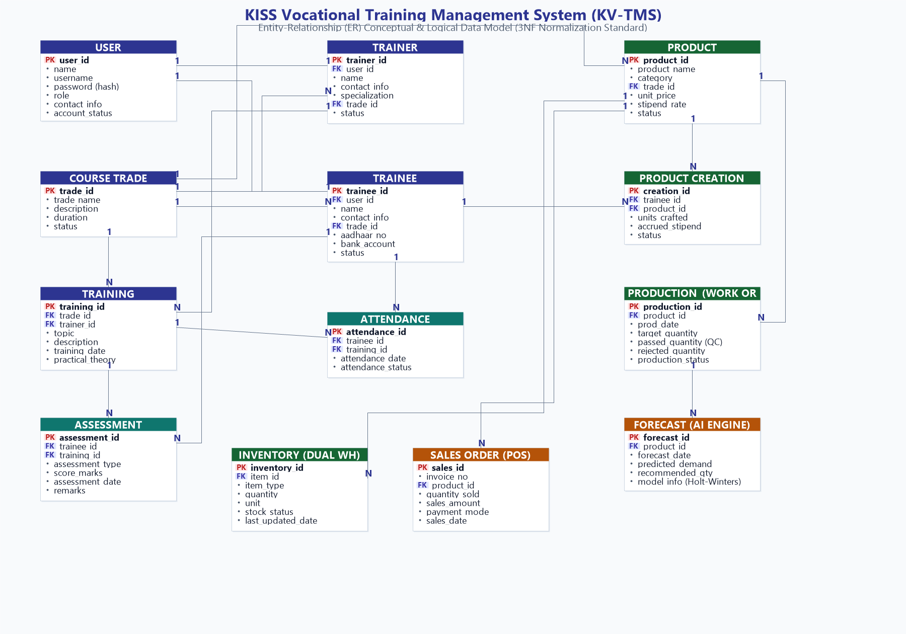

# ENTITY-RELATIONSHIP (ER) MODEL SPECIFICATION
## KISS Vocational Training Management System (KV-TMS)

**Document Identifier:** KV-TMS-ERD-v1.0  
**System Name:** KISS Vocational Training Management System  
**Document Version:** 1.0 (Conceptual & Logical Data Architecture)  
**Date:** October 8, 2026  
**Author:** Mansi Sinha  
**Academic Program:** B.Tech. Computer Science & Engineering  
**Department:** School of Computer Science and Engineering, KIIT Deemed to be University  
**Host Institution:** Kalinga Institute of Social Sciences (KISS), Bhubaneswar, Odisha  

---

## 1. INTRODUCTION & CONCEPTUAL DATA MODELING OBJECTIVES

### 1.1 Purpose of the Entity-Relationship Specification
The **Entity-Relationship (ER) Model Specification** defines the high-level conceptual and logical information architecture governing the **KISS Vocational Training Management System (KV-TMS)**.

While physical database design deals with database engine storage parameters, tablespaces, and SQL data types (documented separately in the *Physical Database Design Specification*), this conceptual specification models **business entities, domain relationships, cardinalities, and structural data invariants** independent of any specific storage engine.

### 1.2 Conceptual Data Modeling Principles (Crow's Foot Standards)
* **Strong Entities:** Independent business objects possessing their own primary key identifiers (`USER`, `COURSE_TRADE`, `PRODUCT`).
* **Weak & Dependent Entities:** Entities whose existence depends upon an associated parent entity (`TRAINER` and `TRAINEE` dependent on `USER`).
* **Associative Entities:** Intersection entities resolving Many-to-Many relationships and capturing associative attributes (`ATTENDANCE` linking Trainees to Trainings; `PRODUCT_CREATION` linking Trainees to Products).
* **Cardinality Ratios:** Standard One-to-One (`1 : 1`), One-to-Many (`1 : N`), and Many-to-Many (`M : N`) mappings.

### 1.3 Subsystem Domain Clustering
The 13 relational entities are organized across five cohesive functional clusters:
1. **Identity & Governance Cluster:** `USER`, `TRAINER`, `TRAINEE`.
2. **Academics & Vocational Training Cluster:** `COURSE_TRADE`, `TRAINING`, `ATTENDANCE`, `ASSESSMENT`.
3. **Craft Product & Workshop Cluster:** `PRODUCT`, `PRODUCT_CREATION`, `PRODUCTION (WORK ORDER)`.
4. **Two-Tier Warehouse & Retail POS Cluster:** `INVENTORY (DUAL WH)`, `SALES ORDER (POS)`.
5. **Predictive Intelligence & Welfare Cluster:** `FORECAST (AI ENGINE)`.

---

## 2. GLOBAL ENTITY-RELATIONSHIP (ER) DIAGRAM

The conceptual data model connects 13 core relational entities across institutional governance, training tracks, production runs, inventory stores, and POS commercialization:

  
*Figure 2.1: KV-TMS Entity-Relationship (ER) Conceptual & Logical Data Model*

### Subsystem Color Palette & Architectural Topology
* **Blue Palette (Identity & Academics):** Platform users, master faculty, student artisans, trade tracks, and workshop training cohorts.
* **Teal Palette (Evaluations & Compliance):** Session attendance marks and craftsmanship evaluation rubrics.
* **Green Palette (Manufacturing & Inventory):** Craft SKU catalog, trainee piece-rate fabrication, batch work orders, and dual-warehouse stock.
* **Amber Palette (Commercialization & AI):** Retail POS sales orders and Holt-Winters 30-day predictive demand curves.

---

## 3. ENTITY CLASSIFICATION & DOMAIN CATALOG

| Entity Name | Entity Type | Primary Key | Domain Cluster | Business Role & Semantic Scope |
| :--- | :--- | :--- | :--- | :--- |
| `USER` | Strong Entity | `user_id` | Identity & Governance | Central system accounts, BCrypt password hashes, and RBAC authorities. |
| `TRAINER` | Dependent (1:1) | `trainer_id` | Identity & Governance | Master faculty profiles, trade specializations, and workshop mentorships. |
| `TRAINEE` | Dependent (1:1) | `trainee_id` | Identity & Governance | Indigenous tribal student artisans, Aadhaar records, and bank accounts. |
| `COURSE_TRADE` | Strong Entity | `trade_id` | Academics & Training | Vocational trade tracks (Handloom, Terracotta, Bamboo, Apparels). |
| `TRAINING` | Strong Entity | `training_id` | Academics & Training | Scheduled vocational workshop modules, lesson topics, and syllabus units. |
| `ATTENDANCE` | Associative | `attendance_id` | Evaluations & Compliance | Daily session attendance marks for enrolled trainees; evaluates 75% rule. |
| `ASSESSMENT` | Associative | `assessment_id` | Evaluations & Compliance | Craftsmanship practical evaluation rubrics, skill scores, and certifications. |
| `PRODUCT` | Strong Entity | `product_id` | Manufacturing & BOM | Finished craft catalog SKUs, piece-rate stipend rates, and selling prices. |
| `PRODUCT_CREATION` | Associative | `creation_id` | Manufacturing & BOM | Artisan fabrication output logs, verified units, and EWYL stipend accruals. |
| `PRODUCTION` | Strong Entity | `production_id` | Manufacturing & BOM | Batch manufacturing work orders, machine runs, and QC yield audits. |
| `INVENTORY` | Dependent (1:N) | `inventory_id` | Warehouse Logistics | Two-tier balances: Warehouse 1 (Raw Materials) vs Warehouse 2 (Finished). |
| `SALES_ORDER` | Strong Entity | `sales_id` | Retail POS Billing | Retail point-of-sale customer transactions, GST tax calculations, and invoices. |
| `FORECAST` | Dependent (1:N) | `forecast_id` | Predictive Intelligence | Holt-Winters 30-day demand curves, safety stocks, and reorder point triggers. |

---

## 4. ENTITY RELATIONSHIP & CARDINALITY MATRIX

| Relationship | Parent Entity | Child Entity | Ratio | Business Semantics & Integrity Invariant |
| :--- | :--- | :--- | :---: | :--- |
| **User to Trainer** | `USER` | `TRAINER` | `1 : 1` | A user account with `ROLE_TRAINER` maps to exactly one master faculty record. |
| **User to Trainee** | `USER` | `TRAINEE` | `1 : 1` | A user account with `ROLE_STUDENT` maps to exactly one student artisan record. |
| **Trade to Trainee** | `COURSE_TRADE` | `TRAINEE` | `1 : N` | Each trade track enrolls multiple students; each student belongs to one trade cohort. |
| **Trade to Training** | `COURSE_TRADE` | `TRAINING` | `1 : N` | A trade curriculum comprises multiple training sessions and workshop milestones. |
| **Trainer to Training**| `TRAINER` | `TRAINING` | `1 : N` | A master craftsman conducts multiple workshop cohorts across the semester. |
| **Training to Attendance**| `TRAINING` | `ATTENDANCE` | `1 : N` | Each workshop session logs attendance marks for all enrolled cohort trainees. |
| **Trainee to Attendance**| `TRAINEE` | `ATTENDANCE` | `1 : N` | Each trainee accumulates daily attendance records feeding the 75% rule. |
| **Training to Assessment**| `TRAINING` | `ASSESSMENT` | `1 : N` | Each practical module records craftsmanship evaluation scores and rubrics. |
| **Trade to Product** | `COURSE_TRADE` | `PRODUCT` | `1 : N` | Each trade department produces a designated catalog of finished craft SKUs. |
| **Product to Fabrication**| `PRODUCT` | `PRODUCT_CREATION`| `1 : N` | Each catalog craft product is fabricated by assigned student artisans. |
| **Product to Production** | `PRODUCT` | `PRODUCTION` | `1 : N` | Each product SKU is manufactured via scheduled batch work orders. |
| **Product to Inventory** | `PRODUCT` | `INVENTORY` | `1 : N` | Tracks dual stock levels across Warehouse 1 (Raw) and Warehouse 2 (Finished). |
| **Product to Sales** | `PRODUCT` | `SALES_ORDER` | `1 : N` | Retail POS transactions decrement available finished stock upon checkout. |
| **Product to Forecast** | `PRODUCT` | `FORECAST` | `1 : N` | AI engine computes 30-day demand curves and recommended production quantities. |

---

## 5. REFERENTIAL INTEGRITY RULES & BUSINESS CONSTRAINTS

### 5.1 Core Relational Invariants
1. **Unique Identity Invariant:** Every student artisan must possess a verified, unique Aadhaar number (`aadhaar_no`) and dedicated bank account before participating in production workshops.
2. **Dual-Warehouse Separation Invariant:** Raw materials (Warehouse 1) and Finished Goods (Warehouse 2) are logically segregated within `INVENTORY` to ensure BOM consumption does not contaminate finished retail stock.
3. **Statutory Attendance Compliance:** Cumulative attendance percentage must remain &ge; 75.0% for trade certification; violation automatically flags `is_at_risk = true`.
4. **Output-Linked EWYL Accrual:** Student stipend entries in `PRODUCT_CREATION` accrue strictly upon Quality Control (QC) verification of passed units ($Passed \times PieceRate$).
5. **Transactional Stock Decrement:** Retail POS sales must acquire pessimistic locks to prevent overselling finished goods inventory.

---

## 6. SPECIFICATION VERIFICATION & SIGN-OFF

This Entity-Relationship Model Specification accurately defines the conceptual information architecture, domain entities, and cardinality constraints of the KISS Vocational Training Management System (KV-TMS).

**Prepared By:** Mansi Sinha  
**Signature:** ____________________________  
**Date:** October 8, 2026  

**Faculty Guide Review:**  
**Department:** School of Computer Science & Engineering, KIIT Deemed to be University  
**Signature:** ____________________________  
**Date:** ____________________________  
