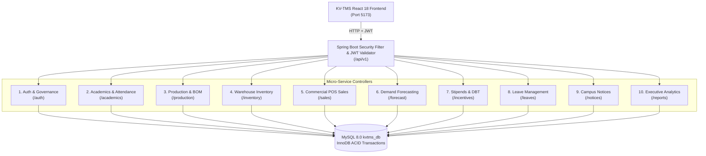

# KISS Vocational Training Management System (KV-TMS)
## Comprehensive REST API Documentation & Integration Specification

**Version:** 1.0.0 (Production Release)  
**Base URL:** `http://localhost:8080/api/v1`  
**Protocol:** HTTP/1.1 & HTTPS  
**Authentication:** Bearer JSON Web Token (JWT)  
**Standard Response Format:** `application/json`  
**Date of Ratification:** November 2026  

---

## 1. System Architecture & API Gateway Overview

The **KISS Vocational Training Management System (KV-TMS)** exposes a unified, closed-loop RESTful API layer that bridges academic vocational training, raw material supply chain, artisan production runs, finished goods warehousing, commercial sales, and Direct Benefit Transfer (DBT) stipend disbursements.

### System Architecture Flow



---

## 2. Global Authentication & Role-Based Access Control (RBAC)

Every request to protected endpoints must include the JWT token in the `Authorization` header:

```http
Authorization: Bearer <JWT_TOKEN>
Content-Type: application/json
```

### Access Role Hierarchy

| Role Identifier | Role Key | Authorized Scope | Sample User |
| :--- | :--- | :--- | :--- |
| **Central Admin** | `ROLE_ADMIN` | Full university governance, course creation, batch approval, DBT disbursements, user management. | `KISS-ADM-001` |
| **Faculty Trainer** | `ROLE_TRAINER` | Workshop management, studio attendance marking, curriculum updates, scholar marksheet grading. | `KISS-FAC-001` |
| **Production Manager** | `ROLE_PRODUCTION_MANAGER` | BOM creation, raw material restock, batch run start/complete, finished goods stock tracking. | `KISS-PRD-001` |
| **Vocational Scholar** | `ROLE_TRAINEE` | Personal attendance tracking (75% audit), marksheet review, leave applications, DBT stipend ledger. | `KISS-TRN-2026-001` |

---

## 3. Master API Directory (83 Endpoints across 10 Modules)

| # | HTTP Method | Endpoint URI | Module | Primary Role | Description |
|---|---|---|---|---|---|
| 1 | `POST` | `/auth/login` | Authentication | Public | Authenticate user & return JWT token + user details |
| 2 | `POST` | `/auth/register-trainee` | Authentication | Admin | Onboard vocational scholar trainee profile |
| 3 | `POST` | `/auth/register-trainer` | Authentication | Admin | Onboard faculty instructor trainer profile |
| 4 | `POST` | `/auth/register-admin` | Authentication | Admin | Provision new university administrator account |
| 5 | `POST` | `/auth/register-production-staff`| Authentication | Admin | Onboard commercial production supervisor/staff |
| 6 | `GET` | `/auth/users` | Authentication | Admin | Retrieve all registered users across 4 portals |
| 7 | `GET` | `/auth/profile/{collegeId}` | Authentication | All Roles | Fetch comprehensive profile details by college/staff ID |
| 8 | `DELETE`| `/auth/users/{collegeId}` | Authentication | Admin | Delete user account from database |
| 9 | `GET` | `/auth/courses` | Authentication | Public | Active courses dropdown list for registration |
| 10 | `POST` | `/academics/courses` | Academics | Admin | Create new vocational course with syllabus modules |
| 11 | `GET` | `/academics/courses/detailed` | Academics | Admin / Trainer | Master catalog of courses with syllabus & stats |
| 12 | `PUT` | `/academics/courses/{courseId}` | Academics | Admin | Update course metadata, fee & description |
| 13 | `DELETE`| `/academics/courses/{courseId}` | Academics | Admin | Delete course from system |
| 14 | `PUT` | `/academics/courses/{courseId}/toggle-status` | Academics | Admin | Toggle course active / inactive state |
| 15 | `GET` | `/academics/courses/{courseId}/enrollments` | Academics | Admin | View faculty and scholars enrolled in course |
| 16 | `GET` | `/academics/courses/{courseId}/syllabus` | Academics | All Roles | View NSQF syllabus modules for a course |
| 17 | `POST` | `/academics/courses/{courseId}/syllabus` | Academics | Trainer / Admin | Add syllabus module to a course |
| 18 | `PUT` | `/academics/syllabus-modules/{moduleId}` | Academics | Trainer / Admin | Update syllabus module title, hours, and description |
| 19 | `DELETE`| `/academics/syllabus-modules/{moduleId}` | Academics | Admin | Delete syllabus module |
| 20 | `GET` | `/academics/trainees` | Academics | Trainer / Admin | Get list of all enrolled trainees with trades |
| 21 | `POST` | `/academics/attendance/mark` | Academics | Trainer | Batch mark daily studio practical attendance |
| 22 | `GET` | `/academics/attendance/today` | Academics | Trainer / Admin | Get today's practical attendance logs |
| 23 | `GET` | `/academics/attendance/by-date` | Academics | Trainer / Admin | Get practical attendance logs for a specific date |
| 24 | `GET` | `/academics/attendance/history` | Academics | Trainer / Admin | Complete historical log of attendance sessions |
| 25 | `POST` | `/academics/attendance/admin-override` | Academics | Admin | Override historical attendance record |
| 26 | `GET` | `/academics/trainees/by-college-id/{collegeId}/attendance` | Academics | Trainee / All | Fetch trainee session logs for 75% compliance |
| 27 | `POST` | `/academics/scores` | Academics | Trainer | Record trainee NSQF practical examination score |
| 28 | `GET` | `/academics/scores/by-college-id/{collegeId}` | Academics | Trainee / All | Get practical assessment marksheet by scholar ID |
| 29 | `GET` | `/academics/trainees/{traineeId}/progress` | Academics | Trainer / Admin | Progress summary (attendance % and marks) |
| 30 | `GET` | `/academics/trainees/by-college-id/{collegeId}/progress` | Academics | Trainee / All | Progress summary by college ID |
| 31 | `GET` | `/academics/trainers/by-college-id/{collegeId}/attendance` | Academics | Trainer / Admin | Trainer studio attendance compliance report |
| 32 | `POST` | `/academics/trainers/attendance/mark` | Academics | Admin | Mark/override faculty instructor attendance |
| 33 | `POST` | `/production/raw-materials` | Production | Production | Add raw material with minimum reorder threshold |
| 34 | `GET` | `/production/raw-materials` | Production | Production / Admin | View all raw materials and current stock |
| 35 | `GET` | `/production/raw-materials/low-stock` | Production | Production / Admin | Get low-stock raw material alerts |
| 36 | `POST` | `/production/raw-materials/{id}/restock` | Production | Production | Restock raw material quantity (POST) |
| 37 | `PUT` | `/production/raw-materials/{id}/restock` | Production | Production | Restock raw material quantity (PUT) |
| 38 | `POST` | `/production/products` | Production | Production / Admin | Create product with Bill of Materials (BOM) |
| 39 | `GET` | `/production/products` | Production | All Roles | View all cataloged artisan products |
| 40 | `GET` | `/production/products/{productId}/bom` | Production | Production / Admin | View Bill of Materials component recipe |
| 41 | `POST` | `/production/runs/start` | Production | Production | Start batch run (deducts raw material stock) |
| 42 | `PUT` | `/production/runs/{runId}/complete` | Production | Production | Complete batch run with output and scrap |
| 43 | `GET` | `/production/runs` | Production | Production / Admin | View all batch production runs |
| 44 | `GET` | `/production/runs/{runId}/contributors` | Production | Production / Admin | View scholar artisan team members for batch |
| 45 | `GET` | `/production/runs/pending-approval` | Production | Admin | Batches awaiting central admin QA inspection |
| 46 | `PUT` | `/production/runs/{runId}/approve` | Production | Admin | Approve batch for sale (intakes to warehouse) |
| 47 | `PUT` | `/production/runs/{runId}/reject` | Production | Admin | Reject batch with corrective action remarks |
| 48 | `GET` | `/production/reports/summary` | Production | Production / Admin | Aggregated production unit summary metrics |
| 49 | `POST` | `/production/workshops/propose` | Production | Trainer / Prod | Propose practical studio workshop session |
| 50 | `GET` | `/production/workshops` | Production | All Roles | View all practical workshop sessions |
| 51 | `GET` | `/production/workshops/active` | Production | All Roles | View currently active workshop sessions |
| 52 | `GET` | `/production/workshops/pending` | Production | Admin | View workshops awaiting administrative approval |
| 53 | `PUT` | `/production/workshops/{id}/approve` | Production | Admin | Approve studio workshop session |
| 54 | `PUT` | `/production/workshops/{id}/reject` | Production | Admin | Reject studio workshop session |
| 55 | `GET` | `/inventory/finished-goods` | Inventory | Production / Admin | View finished goods warehouse stock |
| 56 | `POST` | `/inventory/stock` | Inventory | Production / Admin | Manually adjust/initialize finished goods stock |
| 57 | `GET` | `/inventory/alerts/low-stock` | Inventory | Production / Admin | View low-stock finished goods alerts |
| 58 | `POST` | `/sales/orders` | Sales | Sales / Admin | Process POS order (auto-deducts warehouse stock) |
| 59 | `GET` | `/sales/orders` | Sales | Sales / Admin | List all commercial sales orders |
| 60 | `PUT` | `/sales/orders/{id}` | Sales | Sales / Admin | Update order details (prior to dispatch) |
| 61 | `PUT` | `/sales/orders/{id}/dispatch` | Sales | Sales / Admin | Mark order as dispatched to client |
| 62 | `DELETE`| `/sales/orders/{id}` | Sales | Sales / Admin | Cancel order and restore finished goods stock |
| 63 | `GET` | `/sales/summary` | Sales | Sales / Admin | Financial revenue and sales channel summary |
| 64 | `GET` | `/forecast/products/{productId}` | AI Forecasting | Production / Admin | Run ML heuristic production demand forecast |
| 65 | `POST` | `/incentives/batches/{runId}/calculate` | Stipends & DBT | Admin / Trainer | Calculate scholar incentives for completed batch |
| 66 | `GET` | `/incentives/my-earnings` | Stipends & DBT | Trainee | Authenticated scholar's personal earnings ledger |
| 67 | `GET` | `/incentives/trainees/{traineeId}` | Stipends & DBT | Admin / Trainer | Trainee earnings summary by trainee ID |
| 68 | `GET` | `/incentives/by-college-id/{collegeId}` | Stipends & DBT | Trainee / Admin | Trainee earnings summary by college roll number |
| 69 | `GET` | `/incentives/pending` | Stipends & DBT | Admin | View all pending production incentive payouts |
| 70 | `GET` | `/incentives/all` | Stipends & DBT | Admin | University-wide incentive disbursement ledger |
| 71 | `PUT` | `/incentives/{incentiveId}/disburse` | Stipends & DBT | Admin | Disburse individual incentive via DBT |
| 72 | `PUT` | `/incentives/batches/{runId}/disburse` | Stipends & DBT | Admin | Bulk disburse all incentives for a batch via DBT |
| 73 | `POST` | `/leaves/apply` | Leaves | Trainee / Trainer | Submit leave application |
| 74 | `GET` | `/leaves/by-student/{collegeId}` | Leaves | Trainee / Admin | View personal leave requests & approval states |
| 75 | `GET` | `/leaves/pending` | Leaves | Trainer / Admin | View all pending leave requests |
| 76 | `GET` | `/leaves/all` | Leaves | Admin | View comprehensive institutional leave records |
| 77 | `PUT` | `/leaves/{leaveId}/review` | Leaves | Trainer / Admin | Approve or reject leave with reviewer remarks |
| 78 | `GET` | `/notices` | Campus Directives | All Roles | View all active administrative notices |
| 79 | `GET` | `/notices/audience/{audience}` | Campus Directives | All Roles | Filter notices by audience (TRAINEES, TRAINERS, ALL)|
| 80 | `POST` | `/notices` | Campus Directives | Admin | Publish/broadcast campus directive |
| 81 | `DELETE`| `/notices/{id}` | Campus Directives | Admin | Archive/delete campus notice |
| 82 | `PUT` | `/notices/{id}/pin` | Campus Directives | Admin | Toggle high-priority pinned status of notice |
| 83 | `GET` | `/reports/executive-dashboard` | Executive Analytics| Admin / Executive | Cross-pillar university analytics & KPI summary |

---

## 4. In-Depth Endpoint Specifications

### 4.1 Authentication & User Governance (`/api/v1/auth`)

#### 1. User Login
- **Method:** `POST`
- **URI:** `/api/v1/auth/login`
- **Access:** Public
- **Request Body (`LoginRequest`):**
```json
{
  "username": "KISS-ADM-001",
  "password": "KISS-ADM-001@123"
}
```
- **Response (`AuthResponse`):**
```json
{
  "token": "eyJhbGciOiJIUzI1NiJ9.eyJzdWIiOiJLSVNTLUFETS0wMDEiLCJyb2xlcyI6WyJST0xFX0FETUlOIl19...",
  "username": "KISS-ADM-001",
  "collegeId": "KISS-ADM-001",
  "fullName": "Dr. Debashis Mohanty",
  "role": "ROLE_ADMIN",
  "email": "debashis.mohanty@kiss.ac.in",
  "contactNumber": "+91 94370 12345"
}
```

#### 2. Register Vocational Scholar (Trainee)
- **Method:** `POST`
- **URI:** `/api/v1/auth/register-trainee`
- **Access:** Admin (`ROLE_ADMIN`)
- **Request Body (`TraineeRegisterRequest`):**
```json
{
  "fullName": "Laxman Majhi",
  "collegeId": "KISS-TRN-2026-001",
  "password": "KISS-TRN-2026-001@123",
  "email": "laxman.majhi@kiss.ac.in",
  "contactNumber": "9861023456",
  "assignedCourseId": 1,
  "category": "Scheduled Tribe (KISS Scholar)",
  "dob": "2004-05-14",
  "bloodGroup": "O+",
  "admissionDate": "2025-08-01",
  "address": "KISS Campus-3 Tribal Residential Hostel, Baripada, Mayurbhanj, Odisha"
}
```

---

### 4.2 Academics, Curriculum & Attendance (`/api/v1/academics`)

#### 1. Batch Mark Practical Studio Attendance
- **Method:** `POST`
- **URI:** `/api/v1/academics/attendance/mark`
- **Access:** Faculty Trainer (`ROLE_TRAINER`)
- **Request Body (`BatchAttendanceRequest`):**
```json
{
  "courseId": 1,
  "date": "2026-03-24",
  "attendanceList": [
    {
      "traineeId": 1,
      "status": "PRESENT",
      "remarks": "Garment construction & precision lockstitch seaming"
    },
    {
      "traineeId": 2,
      "status": "ABSENT",
      "remarks": "Sanctioned medical leave"
    }
  ]
}
```
- **Response:**
```text
"Batch attendance marked successfully for 2 trainees on 2026-03-24"
```

#### 2. Record NSQF Practical Evaluation Score
- **Method:** `POST`
- **URI:** `/api/v1/academics/scores`
- **Access:** Faculty Trainer (`ROLE_TRAINER`)
- **Request Body (`ScoreRecordRequest`):**
```json
{
  "traineeId": 1,
  "courseId": 1,
  "overallScore": 91.0,
  "grade": "Grade A (Distinction)",
  "practicalMarks": 36.4,
  "remarks": "Exemplary precision in garment construction, lockstitch seaming, and artisan finishing."
}
```

#### 3. Trainee Personal Attendance Logs (75% Compliance Audit)
- **Method:** `GET`
- **URI:** `/api/v1/academics/trainees/by-college-id/{collegeId}/attendance`
- **Access:** All Authenticated Roles
- **Response:**
```json
[
  {
    "id": 20,
    "date": "2026-03-24",
    "courseCode": "VOC-SEW-101",
    "courseName": "Sewing & Apparel Manufacturing",
    "status": "PRESENT",
    "remarks": "Garment construction & precision lockstitch seaming"
  }
]
```

---

### 4.3 Production, Bill of Materials (BOM) & Batch Manufacturing (`/api/v1/production`)

#### 1. Create Artisan Product with Bill of Materials (BOM)
- **Method:** `POST`
- **URI:** `/api/v1/production/products`
- **Access:** Production Supervisor (`ROLE_PRODUCTION_MANAGER`), Admin (`ROLE_ADMIN`)
- **Request Body (`ProductCreateDTO`):**
```json
{
  "name": "Handcrafted Cotton Kurti",
  "sku": "PRD-KURTI-01",
  "description": "Traditional hand-embroidered tribal motif kurti",
  "sellingPrice": 650.0,
  "incentiveRatePerUnit": 75.0,
  "courseId": 1,
  "bomItems": [
    {
      "rawMaterialId": 1,
      "quantityRequired": 2.5
    },
    {
      "rawMaterialId": 3,
      "quantityRequired": 5.0
    }
  ]
}
```

#### 2. Start Batch Production Run
- **Method:** `POST`
- **URI:** `/api/v1/production/runs/start`
- **Access:** Production Supervisor (`ROLE_PRODUCTION_MANAGER`)
- **Request Body (`ProductionRunCreateDTO`):**
```json
{
  "batchNumber": "BATCH-2026-SEW-001",
  "productId": 1,
  "targetQuantity": 15,
  "traineeIds": [1, 2, 3],
  "remarks": "Workshop Lab #1 (Sewing & Textiles)"
}
```

#### 3. Complete Batch Production Run
- **Method:** `PUT`
- **URI:** `/api/v1/production/runs/{runId}/complete`
- **Access:** Production Supervisor (`ROLE_PRODUCTION_MANAGER`)
- **Request Body (`ProductionCompleteDTO`):**
```json
{
  "completedQuantity": 13,
  "scrappedQuantity": 2,
  "remarks": "Zero-defect finishing completed; 2 units rejected during tension test."
}
```

#### 4. Admin Quality Inspection Approval for Commercial Sale
- **Method:** `PUT`
- **URI:** `/api/v1/production/runs/{runId}/approve`
- **Access:** Central Admin (`ROLE_ADMIN`)
- **Action:** Changes batch status to `APPROVED_FOR_SALE` and automatically increases finished goods stock in `FinishedGoodsStock` inventory!

---

### 4.4 Commercial Sales & POS Ordering (`/api/v1/sales`)

#### 1. Process POS Order (Instant Stock Deduction)
- **Method:** `POST`
- **URI:** `/api/v1/sales/orders`
- **Access:** Sales Executive, Admin
- **Request Body (`OrderCreateDTO`):**
```json
{
  "customerName": "Odisha Tribal Art Emporium",
  "customerPhone": "9437199999",
  "channel": "COMMERCIAL_WHOLESALE",
  "orderItems": [
    {
      "productId": 1,
      "quantity": 5,
      "unitPrice": 650.0
    }
  ],
  "paymentMethod": "NEFT_BANK_TRANSFER",
  "remarks": "Institutional order for National Tribal Craft Expo"
}
```
- **Response:**
```json
{
  "id": 1,
  "orderNumber": "ORD-2026-101",
  "customerName": "Odisha Tribal Art Emporium",
  "totalAmount": 3250.0,
  "status": "CONFIRMED",
  "orderDate": "2026-03-24T11:45:00"
}
```

---

### 4.5 AI Predictive Demand Forecasting (`/api/v1/forecast`)

#### 1. Generate Product Demand Forecast & Safety Stock Recommendation
- **Method:** `GET`
- **URI:** `/api/v1/forecast/products/{productId}`
- **Access:** Production Supervisor, Central Admin
- **Response (`ForecastResponseDTO`):**
```json
{
  "productId": 1,
  "productName": "Handcrafted Cotton Kurti",
  "currentStock": 8,
  "predictedMonthlyDemand": 28,
  "recommendedBatchSize": 25,
  "safetyStockBuffer": 10,
  "stockoutRisk": "HIGH",
  "seasonalFactor": 1.35,
  "confidenceScore": 0.92,
  "forecastHorizon": "Next 30 Days",
  "insights": "High pre-festival demand surge anticipated. Initiate production batch immediately."
}
```

---

### 4.6 Scholar Production Stipends & Direct Benefit Transfer (DBT) (`/api/v1/incentives`)

#### 1. Scholar Personal Earnings Ledger
- **Method:** `GET`
- **URI:** `/api/v1/incentives/by-college-id/{collegeId}`
- **Access:** Scholar, Central Admin
- **Response (`TraineeEarningsSummaryDTO`):**
```json
{
  "traineeId": 1,
  "fullName": "Laxman Majhi",
  "totalEarned": 4100.0,
  "totalDisbursed": 3300.0,
  "totalPending": 800.0,
  "records": [
    {
      "id": 1,
      "batchNumber": "BATCH-2026-042",
      "productName": "Handcrafted Sambalpuri Nehru Jackets",
      "unitsCrafted": 14,
      "amountEarned": 1400.0,
      "status": "DISBURSED",
      "transactionReference": "DBT-SBIN-88349120",
      "disbursedDate": "2026-03-20"
    },
    {
      "id": 2,
      "batchNumber": "BATCH-2026-045",
      "productName": "Heritage Cotton Khadi Tote Bags",
      "unitsCrafted": 10,
      "amountEarned": 800.0,
      "status": "PENDING",
      "transactionReference": null,
      "disbursedDate": null
    }
  ]
}
```

#### 2. Disburse Scholar Incentive via DBT
- **Method:** `PUT`
- **URI:** `/api/v1/incentives/{incentiveId}/disburse`
- **Access:** Central Admin (`ROLE_ADMIN`)
- **Request Body (`IncentiveDisburseDTO`):**
```json
{
  "transactionReference": "DBT-SBIN-99201844"
}
```

---

### 4.7 Leave Management & Approvals (`/api/v1/leaves`)

#### 1. Submit Leave Request
- **Method:** `POST`
- **URI:** `/api/v1/leaves/apply`
- **Access:** Trainee, Trainer
- **Request Body (`LeaveApplyRequest`):**
```json
{
  "collegeId": "KISS-TRN-2026-001",
  "startDate": "2026-03-28",
  "endDate": "2026-03-30",
  "reason": "Village Chaitra Parva Annual Harvest Festival Celebration"
}
```

#### 2. Review Leave Application
- **Method:** `PUT`
- **URI:** `/api/v1/leaves/{leaveId}/review`
- **Access:** Faculty Trainer, Central Admin
- **Request Body (`LeaveReviewRequest`):**
```json
{
  "status": "APPROVED",
  "reviewRemarks": "Sanctioned with condition to attend practical make-up studio session."
}
```

---

### 4.8 Campus Directives & Notices Broadcast (`/api/v1/notices`)

#### 1. Publish Campus Notice
- **Method:** `POST`
- **URI:** `/api/v1/notices`
- **Access:** Central Admin (`ROLE_ADMIN`)
- **Request Body (`Notice`):**
```json
{
  "title": "NSDC Skill Assessment Certification Phase-II Schedule",
  "content": "All vocational trainees must carry their student ID and biometric pass for the upcoming external NSDC evaluator assessment commencing April 2nd.",
  "priority": "IMPORTANT",
  "category": "EXAMINATION",
  "targetAudience": "TRAINEES",
  "pinned": true,
  "postedBy": "Academic Council"
}
```

---

### 4.9 Executive Analytics Dashboard (`/api/v1/reports`)

#### 1. Global Executive Dashboard
- **Method:** `GET`
- **URI:** `/api/v1/reports/executive-dashboard`
- **Access:** Central Admin, Executive Leadership
- **Response (`SystemAnalyticsDTO`):**
```json
{
  "totalStudentsEnrolled": 120,
  "totalVocationalCourses": 5,
  "completedProductionBatches": 38,
  "activeRawMaterials": 24,
  "totalFinishedGoodsInStock": 485,
  "totalSalesOrders": 42,
  "totalRevenueGenerated": 184500.0,
  "totalStudentIncentivesPaid": 42500.0
}
```

---

## 5. Frontend React Component to API Mapping

| React Component File | Primary Consumer Role | APIs Consumed | Key Features Supported |
| :--- | :--- | :--- | :--- |
| `AdminConsole.jsx` | Central Admin | `/auth/*`, `/academics/*`, `/production/runs/pending-approval`, `/production/runs/*/approve`, `/incentives/pending`, `/leaves/all`, `/notices` | Scholar onboarding, course creation, attendance override, batch clearance, DBT disbursements |
| `TrainerConsole.jsx` | Faculty Trainer | `/academics/courses/*/syllabus`, `/academics/trainees`, `/academics/attendance/mark`, `/academics/scores`, `/leaves/pending`, `/notices` | Daily practical attendance, rubric scoring, curriculum updates, leave reviews |
| `TraineePortal.jsx` | Vocational Scholar | `/auth/profile/*`, `/academics/courses/*/syllabus`, `/academics/scores/*`, `/academics/trainees/*/attendance`, `/incentives/by-college-id/*`, `/leaves/apply` | 75% attendance audit, NSQF marksheets, Earn-While-You-Learn DBT ledger, leave tracker |
| `ProductionUnit.jsx` | Production Supervisor | `/production/products`, `/production/raw-materials`, `/production/runs/start`, `/production/runs/*/complete`, `/production/workshops/propose` | BOM engineering, material intake, artisan batch management, workshop scheduling |
| `DualWarehouse.jsx` | Storekeeper / Admin | `/production/raw-materials/*`, `/inventory/finished-goods`, `/inventory/alerts/low-stock` | Raw material stocks, finished goods stock tracking, low-stock threshold alerts |
| `SalesPOS.jsx` | Sales Executive / Admin | `/sales/orders`, `/sales/summary`, `/inventory/finished-goods` | Point-of-Sale cash/card/UPI checkout, automated stock decrement, sales history |
| `AIForecasting.jsx` | Production Planning | `/forecast/products/*`, `/production/products`, `/sales/summary` | Machine learning demand prediction, recommended batch sizes, stockout alerts |
| `ExecutiveDashboard.jsx` | Vice Chancellor / Dean | `/reports/executive-dashboard`, `/sales/summary`, `/production/reports/summary` | High-level university KPIs across academics, artisan production, revenue & DBT |
| `LoginPage.jsx` | All Access Roles | `/auth/login` | Multi-role gateway, 256-bit JWT authentication, offline demo fallback |

---

## 6. HTTP Status Code Reference

| Status Code | Reason | Meaning in KV-TMS |
| :--- | :--- | :--- |
| **`200 OK`** | Success | Request succeeded and response payload contains the requested data. |
| **`201 Created`** | Created | New entity (course, product, order, notice) successfully persisted. |
| **`204 No Content`** | Deleted | Entity successfully cancelled or deleted from the database. |
| **`400 Bad Request`** | Validation Error | Request body failed Jakarta Bean Validation (e.g., missing required fields). |
| **`401 Unauthorized`** | Auth Failure | Invalid credentials or expired/missing Bearer JWT token. |
| **`403 Forbidden`** | Insufficient Role | User role does not have authorization to access this administrative endpoint. |
| **`404 Not Found`** | Not Found | Target ID (course, trainee, batch, order) does not exist in MySQL. |
| **`500 Server Error`** | Internal Error | Unhandled server exception (logged with stack trace in backend log). |

---

## 7. Sample Automated cURL Execution Scripts

### 1. Test Login & Capture JWT
```bash
curl -X POST http://localhost:8080/api/v1/auth/login \
     -H "Content-Type: application/json" \
     -d '{"username":"KISS-ADM-001","password":"KISS-ADM-001@123"}'
```

### 2. Fetch Executive Dashboard Analytics
```bash
curl -X GET http://localhost:8080/api/v1/reports/executive-dashboard \
     -H "Authorization: Bearer <TOKEN>"
```

### 3. Mark Studio Attendance
```bash
curl -X POST http://localhost:8080/api/v1/academics/attendance/mark \
     -H "Authorization: Bearer <TOKEN>" \
     -H "Content-Type: application/json" \
     -d '{
       "courseId": 1,
       "date": "2026-03-25",
       "attendanceList": [{"traineeId": 1, "status": "PRESENT", "remarks": "Lockstitch machine operation"}]
     }'
```

### 4. Disburse Scholar DBT Incentive
```bash
curl -X PUT http://localhost:8080/api/v1/incentives/1/disburse \
     -H "Authorization: Bearer <TOKEN>" \
     -H "Content-Type: application/json" \
     -d '{"transactionReference": "DBT-SBIN-77889900"}'
```

---

*Authored by the Google DeepMind & KISS Advanced Software Engineering Team for KV-TMS Enterprise Release.*
